# miniMP3
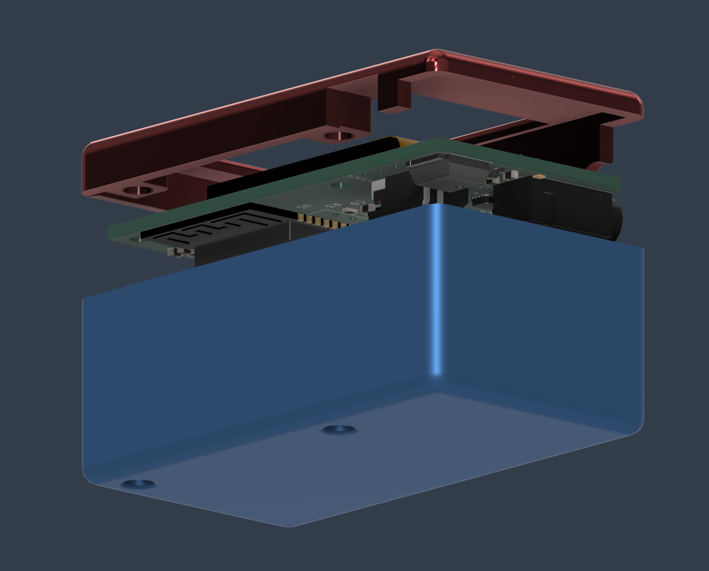
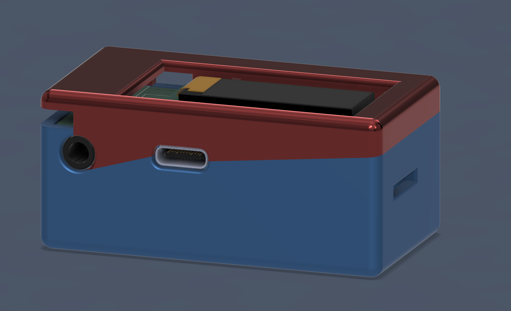

## About
A compact music player. 59.3 x 32 x 27 (mm). Bluetooth and 3.5mm jack compatible. mp3, wav, and flac compatible. 5-band EQ, and more functions when the firmware updates. 

## Idea
I wanted a little mp3 player that was small enough that I could just toss into my shirt pocket or keep it on a necklace. I don't want to be tied so much to my phone, and this seems like a reasonable first step to move a function off. There are also a couple old cds and etc. that I'd like to download.

## Assembly
Solder on:
- the display module
    - Make sure the alignment is correct! Orient the screen upwards and covering the "blank" side of the PCB. Check the pins to make sure they match. Solder in the pins. Clip off the excess length.
    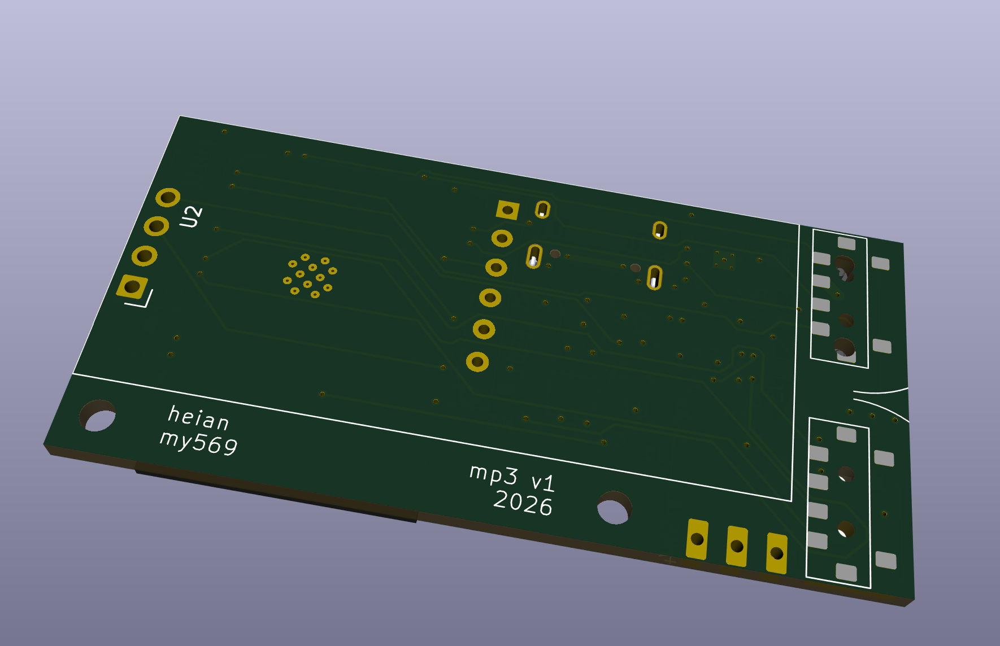
- the SD card module
    - Orient the slot facing outwards. Make sure the pins match on the module and the PCB. Make sure the length of the header pin is appropriate (5mm). Solder in the pins. Clip off the excess length. 
    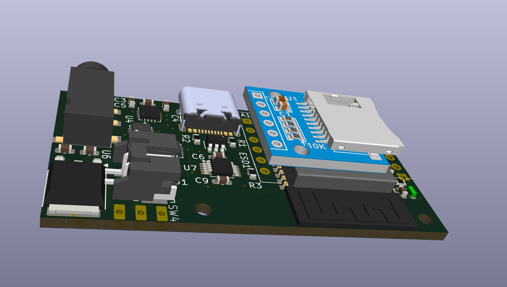
    (throughhole slots below where the module is pictured)
- the boot switch (4x4 push switch)
    - Surface mount on the back. Make sure the orientation is correct (longer side matches the longer side, the shorter side matches the shorter side), then use solder paste and carefully place.
    
    (exposed solder pads next to the ESP32-WROOM-32)
- the power switch (toggle switch)
    - Orient so that the pins align (no specific direction), then solder in the throughhole pins.
    
    (bottom right corner)
- the rotary switches
    - Next to the OLED display module on the same side. Use solder paste to adhere the switches through a surface mount.
    
    (right side, two switches)

Plug in the LiPo Battery (JST-PH 2.0mm).

Insert the heat-sets into the two slots above and below. 

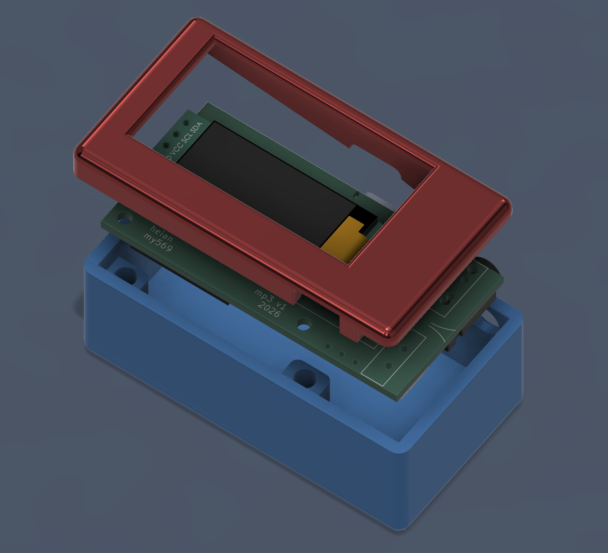

Fasten in the M2 screw on the bottom. 
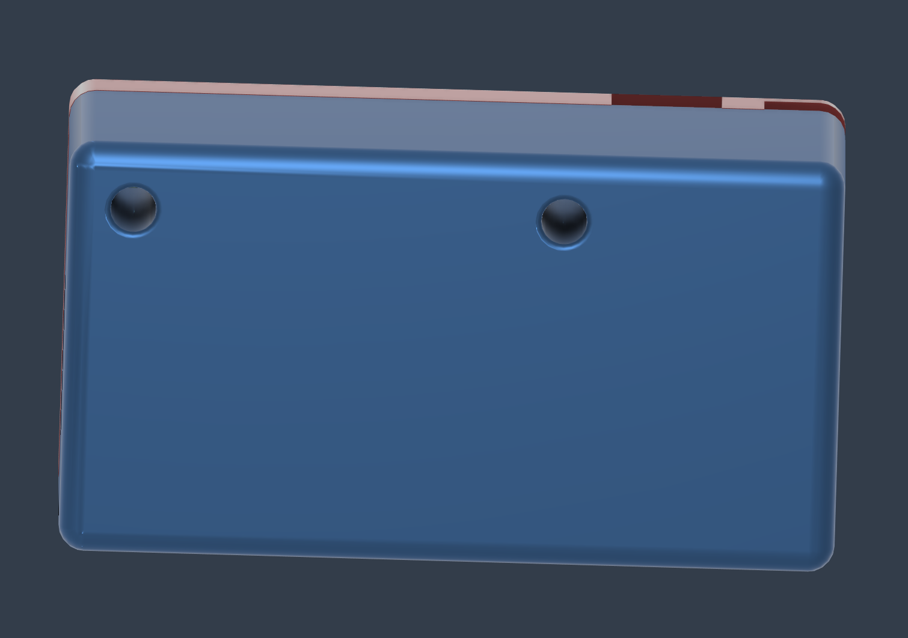

## Firmware

Flash firmware through USB-C, and a platform like Arduino IDE. Hold the boot button, flick the power switch on and off, select the right USB connection, and upload the firmware.

## PCB
### Layer 1 - Signal
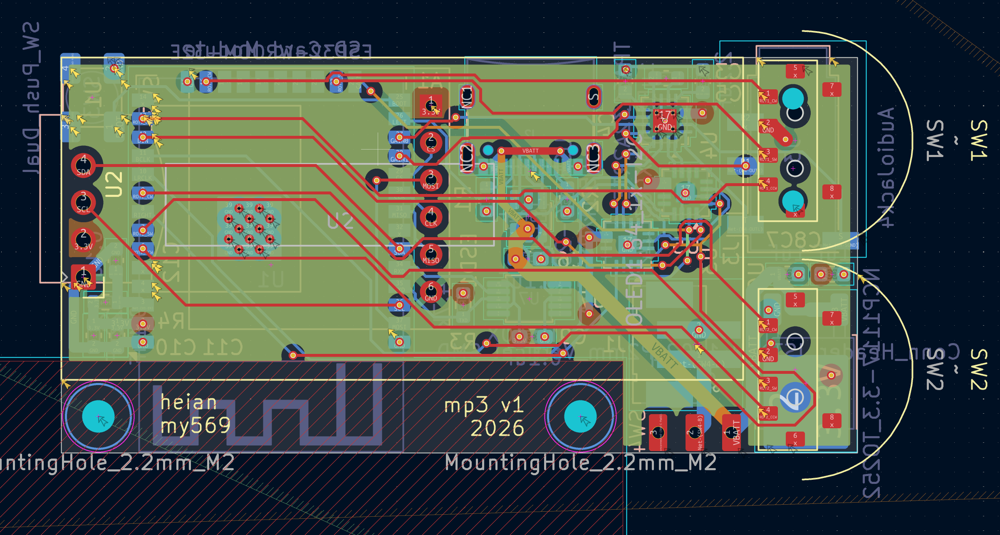
### Layer 2 - GND
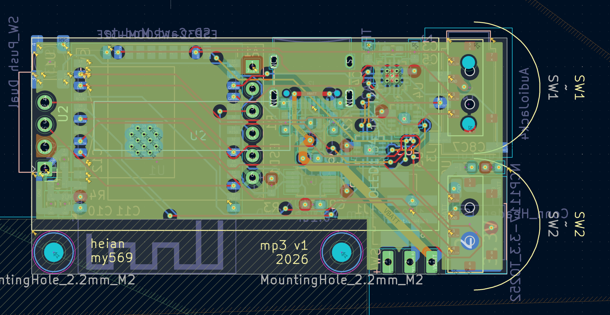
### Layer 3 - Power
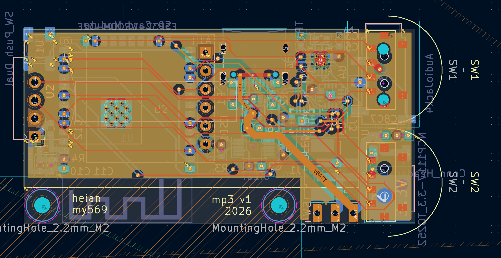
### Layer 4 - Signal
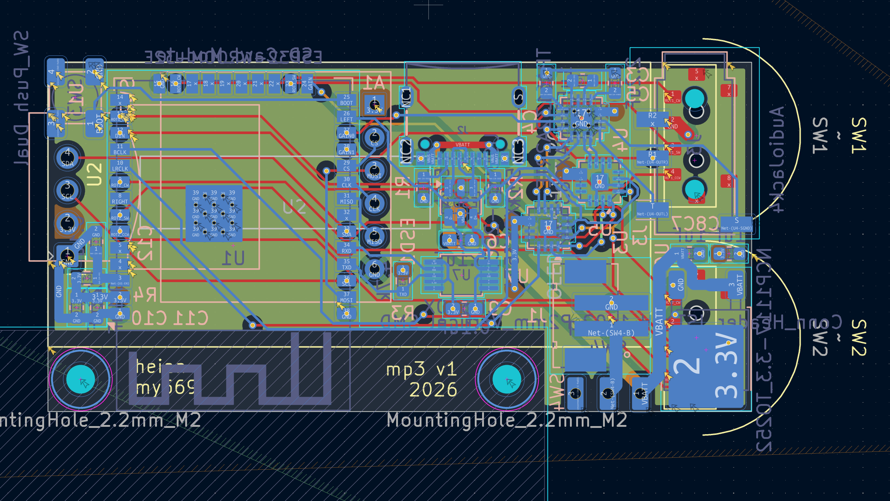
### 3D Model Front

### 3D Model Back

## Schematic
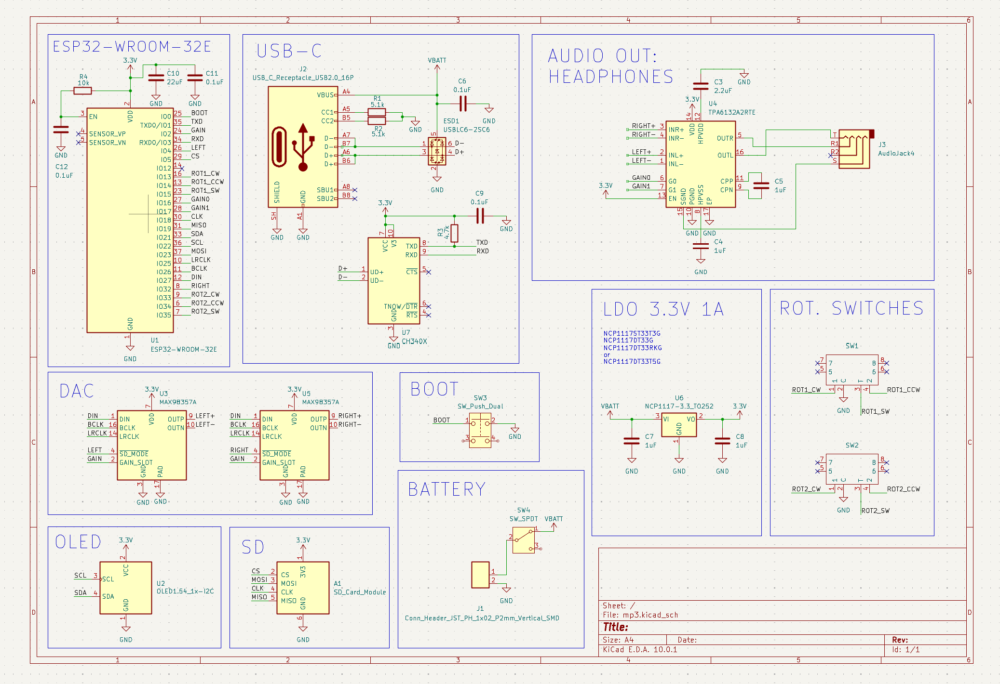 
## CAD

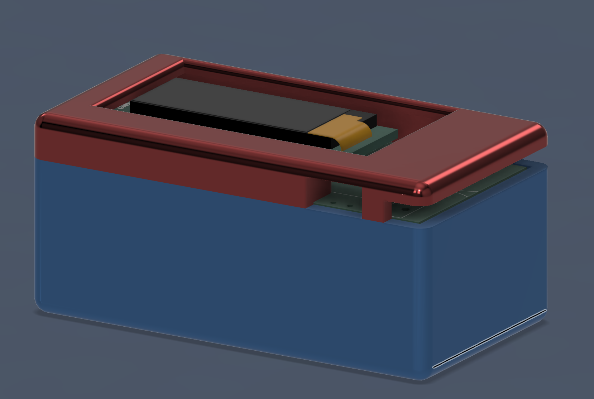

## BOM  
- 1x PCB 
- 1x SD Card Module
- 1x 1.54" OLED Display Module
- 1x PJ320-D Jack
- 1x 4mmx4mm Push Switch
- 1x Sliding Power Switch
- 2x Rotary Switch XUNPU
- 2x M2 Heatset 3.5D 4.5H
- 2x M2 Heatset 3.5D 18H
- 2x M2 Screw 20H 